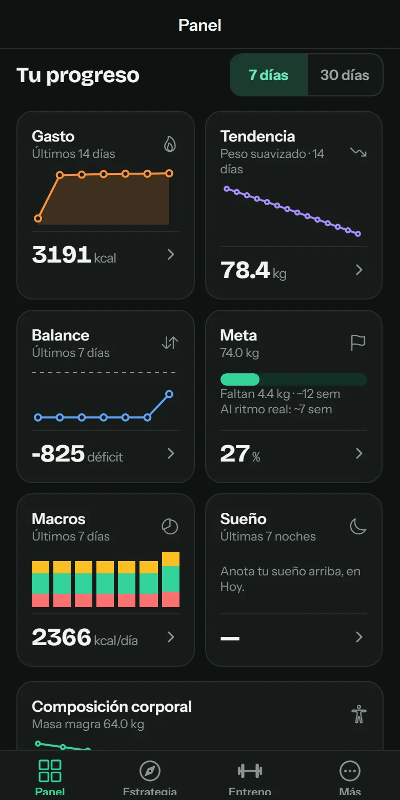
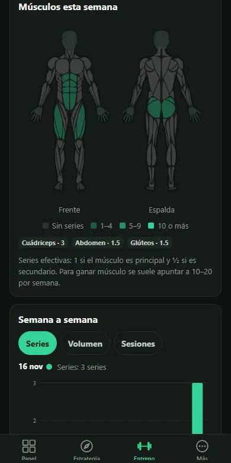
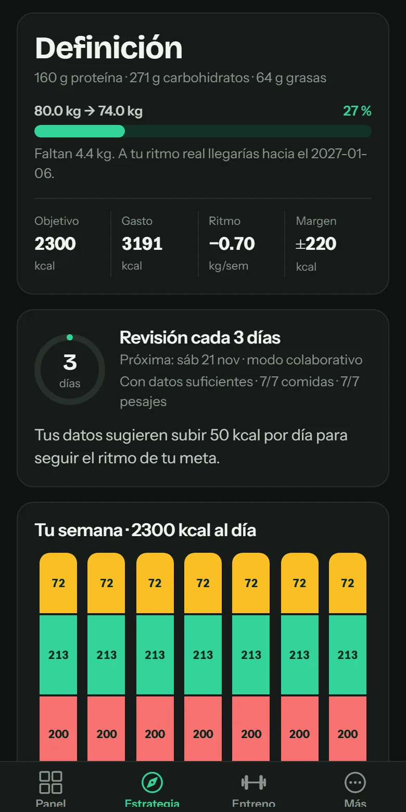
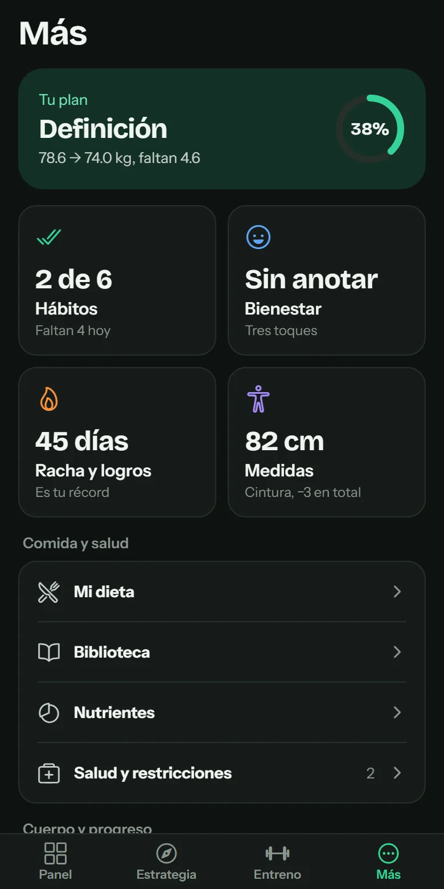

<div align="center">


# Dophamine

**One weigh-in says nothing. The trend does.**

Food, weight, training, sleep and wellbeing in one app. Dophamine separates the signal from the noise and,<br />
every few days, suggests a small adjustment and explains why. No accounts, no server, no ads.

[](https://github.com/s7ex-j/Dophamine/releases/latest)
[](https://github.com/s7ex-j/Dophamine/actions/workflows/checks.yml)
[](LICENSE)
[](https://github.com/s7ex-j/Dophamine/releases/latest/download/dophamine.apk)

### [Download for Android](https://github.com/s7ex-j/Dophamine/releases/latest/download/dophamine.apk) · [Open on iPhone](https://s7ex-j.github.io/Dophamine/pwa/) · [See my progress on the web](https://s7ex-j.github.io/Dophamine/app/) · [Website](https://s7ex-j.github.io/Dophamine/)

<sub>[Español](README.md) · **English**</sub>

<br />

<table>
  <tr>
    <td align="center"><br /><sub><b>Dashboard</b><br />Your progress in charts</sub></td>
    <td align="center"><br /><sub><b>Training</b><br />The muscles of your week</sub></td>
    <td align="center"><br /><sub><b>Strategy</b><br />Your plan and the 3- or 7-day review</sub></td>
    <td align="center"><br /><sub><b>More</b><br />Your plan, your data and settings</sub></td>
  </tr>
</table>

<sub>The app is in Spanish.</sub>

</div>

---

## Why Dophamine

The scale moves with water, salt and glycogen, and a fixed formula can't know how much *you* burn. Dophamine does what you would do with a spreadsheet if you had the time: it smooths your weigh-ins, compares what you eat with how your weight changes and estimates **your real expenditure**. Then it proposes an adjustment, tells you why, and **you decide**.

| | |
| --- | --- |
| **Explainable** | Every proposal shows what data it has and what it still needs. "How it's calculated" walks through it with your numbers. |
| **You stay in control** | The plan never changes without your decision. Automatic mode tells you and can be undone. |
| **Actually private** | Your data lives on your phone. No accounts, no analytics, no server. |
| **Works offline** | Online food search is off by default and only used if you turn it on. |

## What you can do

**Food.** 230 built-in foods (raw and cooked), your own foods and recipes, barcodes, optional Open Food Facts search, saved meals, copy and paste days, alcohol tracked separately and diet types. Or load your diet and follow it with one tap, with swaps based on your training, allergies and your doctor's notes.

**Weight and real expenditure.** Smoothed trend, observed expenditure with its margin and a review every 3 or 7 days. After 15 complete days in a row a self-tuning engine (a Kalman filter) learns how water, food and training move your weight.

**Training.** One workout per day, templates by experience, ~610 exercises with images, set-by-set sessions with suggested load, records, supersets, warm-ups, mesocycles with deloads and a muscle map.

**Sleep and wellbeing.** Sleep, water, mood, energy and stress, a three-tap check-in at the end of the day, a calendar of six daily goals, menstrual cycle, body measurements and progress photos that never leave the phone.

**Your progress on a computer.** Link your phone to the web with a QR code: the connection is encrypted device to device, with no server. The web only reads, in a wide or phone layout.

**Health Connect.** Import weight, body fat, sleep, steps and food from Samsung Health, Google Fit and other apps (Android) without overwriting what you logged by hand. After that, new data comes in once a day on its own.

**Built for the phone.** Read a nutrition label with the camera, dictate the food you're looking for, estimate your bedtime from phone usage, measure your silhouette in progress photos and see what's left of your day in a home-screen widget. All processed on the phone.

## Install

1. Download **[dophamine.apk](https://github.com/s7ex-j/Dophamine/releases/latest/download/dophamine.apk)** on your Android phone (it is always the latest version).
2. Open it and allow installing apps from that source if Android asks.
3. Answer the initial assessment (a couple of minutes) and start logging.

### Updating without losing your data

1. To be safe, open Más → Respaldo → "Compartir respaldo" and save the file outside the app (Drive, Files).
2. Install the new APK on top of the current one, **without uninstalling**. Your data stays.
3. New phone, or already uninstalled? Más → Respaldo → "Restaurar desde un archivo".

The backup does not include progress photo images.

### On iPhone

Open **[s7ex-j.github.io/Dophamine/pwa](https://s7ex-j.github.io/Dophamine/pwa/)** in Safari, tap Share → "Add to Home Screen" and launch it from its icon. It works offline and keeps your data on the phone. It has no reminders, Apple Health, widget, dictation, camera reading or progress photos.

A native iPhone app is under evaluation: Apple requires signing and its own checks. Depending on how people receive it, it could be an install each person signs with their own Apple ID (renewed every 7 days) or an App Store release with a developer account.

> Dophamine is a personal tracking tool. Expenditure is an estimate and the app does not give medical advice.

---

## For developers

Expo SDK 58 · React Native 0.88 · expo-router · TypeScript · SQLite on the phone and `localStorage` on the web · Reanimated · Vitest.

```powershell
git clone https://github.com/s7ex-j/Dophamine.git
Set-Location Dophamine
npm ci
npm run typecheck
npm test
npm run web
```

See [docs/ARCHITECTURE.md](docs/ARCHITECTURE.md), [docs/HOJA_DE_RUTA.md](docs/HOJA_DE_RUTA.md) (roadmap) and [docs/RELEASING.md](docs/RELEASING.md) (in Spanish). Changes per version are in [CHANGELOG.md](CHANGELOG.md).

## License and credits

Copyright (C) 2026 Jharol Vilca Ramos. Free software under the **GNU General Public License, version 3 only** (GPL-3.0-only); see [LICENSE](LICENSE). Up to 0.23.0 (tag `v0.23.0-mit`) the code was released under MIT and those copies keep it. "Dophamine", "Term" and their artwork are covered by [TRADEMARK.md](TRADEMARK.md), not by the code license.

**Exercise data by [RepDB](https://repdb.co) (repdb.co)**, under its own license (not GPL, not redistributed as a dataset). Fonts, libraries and other third parties are listed in [NOTICE.md](NOTICE.md).

<div align="center"><sub>Made by <a href="https://github.com/s7ex-j">Jharol Vilca Ramos</a></sub></div>
