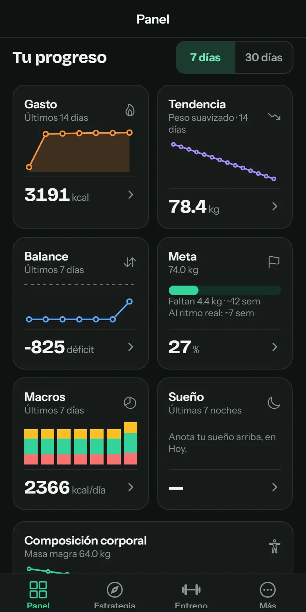
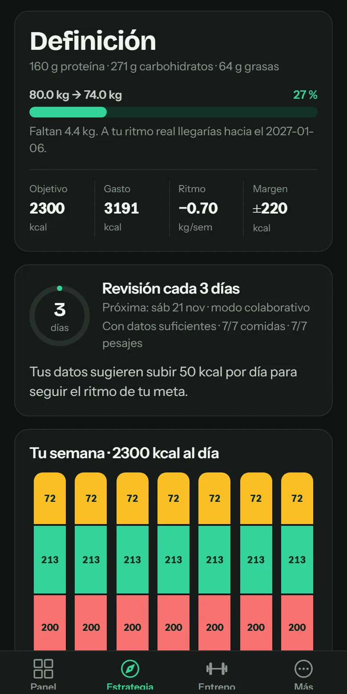
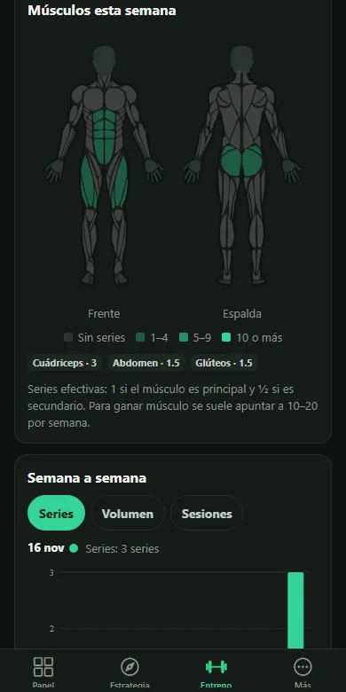
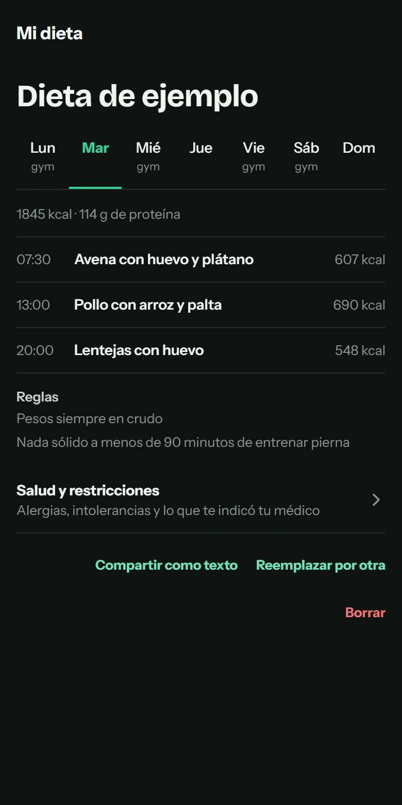

<div align="center">


# Dophamine

**Un pesaje no dice nada. La tendencia sí.**

Comida, peso, entreno, sueño y bienestar en una sola app. Dophamine separa la señal del ruido y,<br />
cada pocos días, te propone un ajuste pequeño con su porqué. Sin cuentas, sin servidor, sin anuncios.

[](https://github.com/s7ex-j/Dophamine/releases/latest)
[](https://github.com/s7ex-j/Dophamine/actions/workflows/checks.yml)
[](LICENSE)
[](https://github.com/s7ex-j/Dophamine/releases/latest/download/dophamine.apk)

### [Descargar para Android](https://github.com/s7ex-j/Dophamine/releases/latest/download/dophamine.apk) · [Abrir en iPhone](https://s7ex-j.github.io/Dophamine/pwa/) · [Ver mi progreso en la web](https://s7ex-j.github.io/Dophamine/app/) · [Sitio](https://s7ex-j.github.io/Dophamine/)

<sub>**Español** · [English](README.en.md)</sub>

<br />

<table>
  <tr>
    <td align="center"><br /><sub><b>Panel</b><br />Lo que te queda del día y tu progreso</sub></td>
    <td align="center"><br /><sub><b>Estrategia</b><br />Tu plan y la revisión cada 3 o 7 días</sub></td>
    <td align="center"><br /><sub><b>Entreno</b><br />Tu semana y los músculos trabajados</sub></td>
    <td align="center"><br /><sub><b>Dieta</b><br />Tu dieta por día, con horario</sub></td>
  </tr>
</table>

</div>

---

## Por qué Dophamine

La báscula sube y baja por agua, sal y glucógeno. Contar calorías con una fórmula fija falla porque cada cuerpo gasta distinto. Dophamine hace lo que harías con una hoja de cálculo si tuvieras tiempo: suaviza tus pesajes, cruza lo que comes con cómo cambia tu peso y estima **tu gasto real**. Luego te propone ajustar, te dice por qué y **tú decides**.

| | |
| --- | --- |
| **Explicable** | Cada propuesta muestra qué datos tiene y cuáles le faltan. "Cómo se calcula" lo enseña paso a paso con tus números. |
| **Bajo tu control** | El plan nunca cambia sin tu decisión. En modo automático te avisa y se puede deshacer. |
| **Privado de verdad** | Tus datos viven en tu teléfono. Sin cuentas, sin analítica, sin servidor. |
| **Sin conexión** | Funciona offline. La búsqueda de alimentos en internet viene apagada y solo se usa si la enciendes. |

## Qué puedes hacer

**Comida**
230 alimentos incluidos (crudo y cocido), alimentos y recetas propias, código de barras, búsqueda opcional en Open Food Facts, comidas guardadas, copiar y pegar días, alcohol aparte y tipos de plan. O carga tu dieta y síguela con un toque, con alternativas según tu entreno, tus alergias y lo que indicó tu médico.

**Peso y gasto real**
Tendencia suavizada, gasto observado con su margen y una revisión cada 3 o 7 días. Con 15 días seguidos de datos entra un motor de autoajuste (filtro de Kalman) que aprende cómo te cambian el agua, la comida y el entreno.

**Entreno**
Una semana con un entreno por día, plantillas por experiencia, ~610 ejercicios con imagen, sesión serie por serie con carga sugerida, récords, superseries, calentamiento, mesociclos con descarga y mapa muscular.

**Sueño y bienestar**
Sueño, agua, ánimo, energía y estrés, un chequeo de tres toques, ciclo menstrual, medidas corporales y fotos de progreso que nunca salen del teléfono.

**Tu progreso en la computadora**
Conecta el teléfono con la web por código QR: la conexión va cifrada de un dispositivo al otro, sin servidor. La web solo lee, en vista ancha o de celular.

**Health Connect**
Trae peso, % de grasa, sueño, pasos y comida desde Samsung Health, Google Fit y otras apps (Android), sin pisar lo que anotaste a mano. Después, lo nuevo entra solo una vez al día.

**Hecho para el teléfono**
Lee una etiqueta nutricional con la cámara, dicta el alimento que buscas, estima tu hora de dormir con el uso del teléfono, mide tu silueta en las fotos de progreso y mira lo que te queda del día en un widget. Todo se procesa dentro del teléfono.

## Term

Term es la mascota de Dophamine: te recibe, te explica cada pregunta de la evaluación, celebra tus rachas y te dice cuándo algo se puede mejorar. Su nombre e ilustraciones tienen su propia política de marca ([TRADEMARK.md](TRADEMARK.md)).

## Instalar

1. Descarga **[dophamine.apk](https://github.com/s7ex-j/Dophamine/releases/latest/download/dophamine.apk)** en tu teléfono Android (siempre es la última versión).
2. Ábrelo y permite instalar apps de esa fuente si Android lo pide.
3. Responde la evaluación inicial (un par de minutos) y empieza a registrar.

### En iPhone

Abre **[s7ex-j.github.io/Dophamine/pwa](https://s7ex-j.github.io/Dophamine/pwa/)** en Safari, toca Compartir → "Agregar a pantalla de inicio" y ábrela desde su ícono. Funciona sin conexión y guarda los datos en el teléfono. No trae recordatorios, Apple Health, widget, dictado, lectura con la cámara ni fotos de progreso.

La app nativa para iPhone está en evaluación: Apple exige firma y controles propios. Según cómo la reciban quienes la usen, podría ser una instalación que cada persona firma con su Apple ID (se renueva cada 7 días) o una publicación en la App Store con cuenta de desarrollador.

### En la computadora

¿Prefieres verlo en la computadora? Abre **[el visor web](https://s7ex-j.github.io/Dophamine/app/)** y conecta tu teléfono con el código QR.

> Dophamine es una herramienta de seguimiento personal. El gasto es una estimación y la app no da consejo médico.

---

## Para desarrolladores

Expo SDK 58 · React Native 0.88 · expo-router · TypeScript · SQLite en el teléfono y `localStorage` en la web · Reanimated · Vitest.

```powershell
git clone https://github.com/s7ex-j/Dophamine.git
Set-Location Dophamine
npm ci
npm run typecheck
npm test
npm run web
```

| Comando | Qué hace |
| --- | --- |
| `npm run web` | La app en el navegador (visor de solo lectura; la app completa con `dophamine.web-mode = full` en localhost) |
| `npm test` | Pruebas de dominio con Vitest |
| `npm run e2e` | Recorre los flujos principales en Chrome sin ventana |
| `npm run format` | Prettier |

```text
app/                 Pantallas (expo-router); componen secciones y no calculan
src/features/        Dominio por área, con sus pruebas (*.test.ts) y repositorios (.ts / .web.ts)
src/components/      Piezas visuales compartidas
src/db/              SQLite en el teléfono y almacén local en la web
web/                 Sitio del proyecto (Vite, React 19, Tailwind 4)
docs/                Arquitectura, privacidad, hoja de ruta y publicación
```

Más en [docs/ARCHITECTURE.md](docs/ARCHITECTURE.md) (fórmulas, límites y datos), [docs/HOJA_DE_RUTA.md](docs/HOJA_DE_RUTA.md) (qué sigue) y [docs/RELEASING.md](docs/RELEASING.md) (cómo se publica el APK). Los cambios de cada versión están en [CHANGELOG.md](CHANGELOG.md).

## Licencia y créditos

Copyright (C) 2026 Jharol Vilca Ramos. Software libre bajo la **GNU General Public License, versión 3 únicamente** (GPL-3.0-only); texto completo en [LICENSE](LICENSE). Hasta la 0.23.0 (etiqueta `v0.23.0-mit`) el código se publicó bajo MIT y esas copias la conservan.

**Exercise data by [RepDB](https://repdb.co) (repdb.co).** Las ilustraciones, instrucciones y parte del catálogo de ejercicios vienen del catálogo gratuito de RepDB, con su propia licencia: no quedan bajo la GPL y no se redistribuyen como dataset. Fuentes, librerías y demás terceros en [NOTICE.md](NOTICE.md). Privacidad y salud en [docs/PRIVACY.md](docs/PRIVACY.md).

¿Quieres contribuir? Revisa [CONTRIBUTING.md](CONTRIBUTING.md). Dophamine es gratis y sin anuncios. <!-- TODO: enlace de donaciones -->

<div align="center"><sub>Hecho por <a href="https://github.com/s7ex-j">Jharol Vilca Ramos</a></sub></div>
